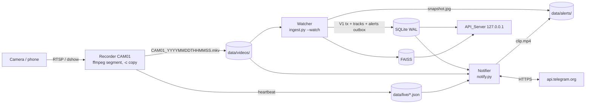

# Design Document: NAB Sentry V2 (Steps 1-2: Measure, Live Monitoring)

## Overview

V2 adds live cameras, tracking, zone rules and Telegram alerts on top of the V1 core without changing V1's storage guarantees. Live video is recorded to short Segment files first; each Closed_Segment then goes through the V1 transactional pipeline, extended with a tracker and a rule engine. Alerts are written to an Outbox table inside the Segment's transaction and delivered by a separate Notifier process, the only component allowed onto the network.

### Goals

- Every second of live video is on disk as a playable file before any model runs.
- Alerts are deterministic and explainable (class + zone + schedule + trigger), never lost and never duplicated, including across crashes.
- V1 search results for the same footage are unchanged.
- All non-trivial logic (geometry, tracker association, rule evaluation, schedules, state machine, segment closing) is in pure functions property-tested with Hypothesis.

### Non-goals

Step 3 (activity log from Tracks + Zones + CLIP attribute tags; on-demand small VLM, first candidate Qwen3-VL 2B; opt-in cloud VLM), embedder change (Step 4), sub-segment alert latency (live frame tap), persistence of tracker state across process restarts (a restart ends all Tracks), web zone editor.

### Delivery phasing

| Phase | Scope | Exit criterion |
|---|---|---|
| A (Step 1) | benchmark on real video, contact sheet + ground truth, ROI + gate sweep, `vlm_bench.py`, decision note | README has measured tables and the decision note |
| B1 | Camera_Config, Recorder, Watcher, replay tool | Phone/IP camera produces Segments that are ingested and searchable |
| B2 | Detector low-conf, Track_Rate path, Tracker, schema v2 | Tracks stored for replayed footage; V1 search unchanged |
| B3 | Zones, Rules, Outbox, snapshot | `alerts` rows appear for replayed footage |
| B4 | Notifier, clips, commands, health, retention, supervisor | Alerts arrive on a test Telegram chat |
| B5 | Acceptance runs (Req 17) | Report with precision, recall, Alert_Latency |

### Findings that shape the design

- **Measured:** the Compilation_Video passes 269/387 sampled frames (69.5%) through the gate. This is dense curated activity, not gate failure, so gate efficiency must be measured on Continuous_Footage (Req 3.4).
- **Measured, then dropped:** `gemma4:e2b` (Q4_K_M, 5.1 B total parameters, 7.2 GB on disk, thinking on by default) loaded at 6.7 GB in Ollama 0.40.6, took 16 s for a new single frame and 21-23 s for a new 2x2 storyboard (7 s image encoding, then about 12 tokens/s), and did not see images correctly: clear daytime scenes were described as "a sheet of paper with a grid of numbers", and text images came back as garbage. It was removed. `vlm_bench.py` now runs a vision sanity check before timing any model, and changes one pixel per call so the server's prompt cache never makes repeat calls look 7 s faster.
- **Measured: `qwen3-vl:2b-instruct`** passes the vision sanity check and describes scenes correctly, with occasional invented details. Ollama encodes every image into about 1,100 tokens regardless of input size, which takes 35-48 s on this CPU; with a one-sentence answer a call takes about 40 s; process RSS peaks at about 4.7 GB. Usable on demand, never per event.
- **Measured: OpenCLIP zero-shot attribute tags** (24 person + 12 vehicle crops from the Compilation_Video, checked by eye; cost about 2 ms per crop because the crop embeddings already exist):
  - vehicle colour and type: about 80% correct; uncertain cases mostly abstain;
  - person top colour: right on clean single-person crops, wrong when a crop contains several people (about 60% overall);
  - clothing type, carried objects and headwear: unreliable (about 40% or less). These are left to the on-demand VLM.
  - About a quarter of the sampled "person" crops were detector false positives (title-card text, a cat, a fence, window blinds) at `det_conf` 0.35. Tracking with `track_min_hits` and tagging from the best crop of a confirmed Track, with a vote across its crops, should remove most of them; Step 3 measures that.
- **Tracking needs more than 1 fps.** ByteTrack associates by IoU between consecutive frames; at 1 fps a walking person's boxes often do not overlap. Detection + tracking therefore run at Track_Rate while there is activity; embedding stays at Sample_Rate.
- **Measured (2026-10-18, real 1376x776 video, AC power, Balanced plan, 4 ONNX threads):** detector 103.6 ms/frame, embedder 126.7 ms/image at batch 8, decode 3.2 ms/frame; projected 26.4 min of ingest per footage hour at continuous activity. These are 2-3x slower than the V1 synthetic numbers. At 5 fps the detector alone would take ~52% of the CPU per active camera, so the Track_Rate default (5) is provisional: task 4.3 measures the detector at input sizes 416/480 and Track_Rate 2-3, and the decision note (Req 5) fixes it.
- **ByteTrack needs low-confidence detections** for its second association pass; V1 discards everything below `det_conf`.
- **Segments as `.mkv`**: an MP4 whose writer dies has no `moov` atom and is unreadable; Matroska stays readable up to the last written cluster. Stream copy keeps the Recorder near 0% CPU.
- **Telegram Bot API** is plain HTTPS + JSON/multipart; `httpx` (already pinned) is enough, no bot framework needed.

## Architecture

### Processes



The processes communicate only through files and SQLite. SQLite is already in WAL mode; every connection sets `busy_timeout = 5000`. The Watcher holds `BEGIN IMMEDIATE` for one Segment (about 1-5 s for a 10 s Segment); the Notifier's transactions are single-row updates.

### Ingest flow per Segment (changes from V1 in bold)

1. Src_Hash, metadata from the file name, open the source (V1).
2. `BEGIN IMMEDIATE`; camera + videos row; playback job (V1; a stream-copied H.264 `.mkv` is remuxed, not re-encoded).
3. **Snapshot the camera's live state** (tracker, zone membership, rule progress) for rollback.
4. **Sampler at Track_Rate.** For each frame:
   - Motion_Gate evaluates (with the camera ROI). **If the gate rejects the frame and no Track is active, skip it** (as V1).
   - **Scene_Cut check → end all Tracks.**
   - **Detector (high + low detections) → Tracker.update → track observations.**
   - **Zone membership + rule evaluation → zero or more alerts rows + snapshot JPEGs** (recorded in `written_files`).
   - If the frame is on the Sample_Rate cadence and passed the gate: `frames` row, Thumbnail, frame + high-crop embeddings as V1, **crop vectors carry `track_id`**.
5. Flush embeddings; **upsert `tracks` rows and insert `track_obs`**; finalize video; FAISS add + save; COMMIT (V1 order).
6. On any compensated failure: V1 compensation **plus restore of the snapshotted live state**.

Which frames are "on the Sample_Rate cadence": with Track_Rate = k × Sample_Rate (k integer, validated), every k-th Track_Rate frame. When Track_Rate is not a multiple, the cadence is the first Track_Rate frame at or after each Sample_Rate target time (same target-time rule as the V1 Sampler).

### Key design decisions

1. **Segments, not in-memory streams.** Reuses V1 transactional ingest unchanged; crash recovery is "re-ingest the file". Cost: Alert_Latency ≥ Segment_Length. Accepted for Step 2; measured in Req 17.
2. **Outbox for Alerts.** Alerts are rows written in the Segment's transaction. A rolled-back Segment produces no Alert; a crashed Notifier resumes from row state. Delivery is idempotent per (alert, chat) through stored message IDs.
3. **Rules are deterministic** and evaluated during ingest from Tracks; no model judges anything in Step 2. `severity: verify` is stored and behaves as `immediate` until Step 3.
4. **Live state lives in the Watcher process**, keyed by camera, carried between consecutive Segments, snapshotted before each Segment and restored on rollback. A Watcher restart resets it (Tracks end; dwell timers restart). Cooldowns are derived from the `alerts` table, so they survive restarts.
5. **Detection-only frames are not `frames` rows.** `track_obs` stores `(video_id, offset_s, abs_epoch_ms)` directly, so `frames`/`vectors`/FAISS semantics and V1 search are untouched.
6. **The Notifier is the only network process**; ingest and API keep V1 isolation tests. Ollama (Step 3) is loopback.
7. **Tracker written in-house** (numpy, greedy IoU association, constant-velocity prediction). Avoids importing Ultralytics at runtime (a V1 rule) and keeps the logic property-testable. Greedy matching instead of Hungarian is acceptable at ≤ 20 objects per frame.

## Components and Interfaces

### config.py (new fields)

| Field | Default | Allowed | Notes |
|---|---|---|---|
| `motion_roi` | `None` | 4 floats in 0..1, x1<x2, y1<y2 | Per camera from Camera_Config; Config value is the fallback |
| `track_rate` | 5.0 | 1..15, ≥ `sample_rate` | |
| `det_low_conf` | 0.1 | 0..1, ≤ `det_conf` | |
| `track_match_iou` | 0.3 | 0.05..0.95 | |
| `track_min_hits` | 3 | 1..30 | |
| `track_buffer_s` | 2.0 | 0.2..30 | |
| `scene_cut_frac` | 0.6 | 0.1..1.0 | |
| `segment_gap_reset_s` | 3.0 | ≥ 0 | |
| `alert_clip_pre_s` / `alert_clip_post_s` | 3.0 / 5.0 | 0..30 | |
| `alert_clip_width` | 640 | 160..1920 | |
| `alert_max_attempts` | 8 | 1..100 | |
| `camera_offline_factor` | 3.0 | 1.5..100 | |
| `disk_low_gb` | 10.0 | ≥ 0 | |
| `retention_days` / `alert_retention_days` | 7 / 30 | 1..3650 | |

Cross-field checks (`track_rate ≥ sample_rate`, `det_low_conf ≤ det_conf`) are added to `_CHECKS` as two-argument checks like `_default_limit`.

### live/camera_config.py

`load_cameras(path) -> list[CameraSpec]` with `CameraSpec(camera_id, label, source, segment_s, roi, zones: dict[str, Polygon], lines: dict[str, Line])`. Returns all issues at once (`CameraConfigError(issues)`), mirroring `ConfigError`. `mask_url(url)` replaces user info with `***`.

### live/recorder.py + scripts/record.py

`recorder_command(spec, out_dir, ffmpeg) -> list[str]` (pure):

```
ffmpeg -hide_banner -nostdin -loglevel warning
  [-rtsp_transport tcp -timeout 10000000 | -f dshow -i video=<name>]
  -i <source> -map 0:v:0 -c copy -an
  -f segment -segment_time <segment_s> -segment_format matroska
  -reset_timestamps 1 -strftime 1
  data/videos/<CAMERA_ID>_%Y%m%dT%H%M%S.mkv
```

`dshow` sources need re-encoding (raw frames): `-c:v libx264 -preset veryfast -tune zerolatency -g <2 × fps>` instead of `-c copy`. `-force_key_frames "expr:gte(t,n_forced*<segment_s>)"` keeps segment boundaries exact when encoding. `Supervisor` loop: start, wait, on exit sleep `backoff(n)` = min(60, 2^n) s, reset n after 60 s of healthy running. Heartbeat written by a thread every `min(5, segment_s)` s from the newest file in `data/videos/` for that camera.

Segment start time comes from the file name (wall clock at segment open, 1 s resolution). Clock drift between ffmpeg's segment cut and the name is under 1 s; accepted.

### ingest/watch.py + `scripts/ingest.py --watch`

`closed_segments(listing, now, segment_s, seen) -> list[Path]` (pure): per camera, sort by start time from the name; a file is closed if a later file of the same camera exists or `now - mtime ≥ segment_s + 5` and its size is unchanged since the last poll. The loop polls every 1 s, ingests closed segments in order, and keeps `failures[path]` for up to 2 retries. Retention runs once per hour (see below).

### ingest/detector.py (change)

`detect()` keeps detections ≥ `det_low_conf`; `Detection` gains `high: bool`. The pipeline's crop path filters `high`. NMS runs over all kept boxes (unchanged code path, lower threshold).

### track/bytetrack.py

```python
@dataclass
class TrackState: id, cls, box, velocity, hits, last_seen_s, confirmed
class Tracker:
    def __init__(self, match_iou, min_hits, buffer_s): ...
    def update(self, offset_s, detections) -> list[TrackedDetection]  # (track_id | None, detection)
    def end_all(self) -> list[TrackState]
    def snapshot(self) -> bytes / restore(blob)  # deepcopy-based
```

Per class: predict each live track's box (`box + velocity × dt`), greedy-match high detections by descending IoU ≥ `match_iou`; match remaining tracks to low detections the same way; unmatched high detections start tentative tracks; tracks unmatched for > `buffer_s` end. Velocity is an exponential moving average of box-centre displacement per second (α = 0.5). Track IDs are allocated by the Metadata_Store (`tracks.track_id` AUTOINCREMENT) at confirmation; tentative tracks have no ID and produce no observations until confirmed (their earlier hits are then back-filled).

Scene_Cut: the Motion_Gate already computes the changed fraction against the previous evaluated frame; the pipeline calls `tracker.end_all()` when it is ≥ `scene_cut_frac`.

### rules/geometry.py

Pure: `point_in_polygon(pt, poly)` (ray casting, boundary inclusive via an on-segment test), `anchor(box) = ((x1+x2)/2, y2)` normalized by frame size, `segment_cross(p, q, a, b) -> -1 | 0 | +1` (sign of the side change of p→q across line a→b, 0 if no proper intersection).

### rules/engine.py

```yaml
# config/rules.yaml
rules:
  - id: yard-night
    name: "Person in yard at night"
    camera: CAM01
    zone: yard               # or line: gate-line, direction: in|out
    classes: [person]
    schedule: {days: [mon, tue, wed, thu, fri, sat, sun], start: "22:00", end: "06:00"}
    trigger: {type: enter}   # dwell: {type: dwell, seconds: 20}; count: {type: count, min: 3}
    debounce: 2              # consecutive qualifying observations
    cooldown_s: 300
    severity: immediate      # immediate | verify (verify == immediate until Step 3)
```

`evaluate(rule, obs, state, now_local, last_alert_epoch) -> (fires: bool, state')` is pure. `state` per (rule, track): consecutive qualifying count, zone entry time (dwell), last anchor (cross), fired flag. `count` uses the set of confirmed tracks currently qualifying. Schedule check uses the frame's Absolute_Timestamp converted with `to_aware_local` (DST-safe), window `start ≤ t < end` or wrapped. Cooldown: `last_alert_epoch` comes from `SELECT max(trigger_epoch_ms) FROM alerts WHERE rule_id=? AND camera_id=? AND state != 'suppressed'` plus alerts staged in the current transaction.

Mutes are read from the `rule_mutes` table at each Segment start; an Alert fired while muted gets state `suppressed`.

### alerts/media.py

`draw_snapshot(image, box, zone_poly, caption) -> jpg` (written by ingest to `data/alerts/a<alert_id>.jpg`). `clip_command(segments, start_s, dur_s, width)` (pure) builds an ffmpeg concat-demuxer command over the covering Segments → `data/alerts/a<alert_id>.mp4` (`-c:v libx264 -preset veryfast -crf 28 -vf scale=<w>:-2 -an -movflags +faststart`).

### notify/telegram.py + scripts/notify.py

`TelegramClient(token, transport)` wraps `sendPhoto`, `sendVideo`, `editMessageCaption`, `sendMessage`, `getUpdates(offset, timeout=25)`, `answerCallbackQuery`. Transport is injectable (`httpx.Client` in production, a fake in tests). 429 → sleep `parameters.retry_after`.

Main loop (single thread, two cooperative tasks on a 1 s tick):

1. **Outbox:** for each Alert in `pending|photo_sent` with `next_attempt_epoch_ms ≤ now`, advance the state machine below.
2. **Updates:** `getUpdates` with the stored offset (`kv['telegram_offset']`), handle commands and button callbacks, persist the new offset.
3. **Health** every 10 s: heartbeats → `camera_offline` / `camera_recovered`; disk → `disk_low`.

Alert state machine:

```
pending --photo ok (all chats)--> photo_sent --clip ok/clip failed (note)--> sent
   |                                   |
   +-- error: attempts++, backoff -----+--> failed (attempts ≥ alert_max_attempts)
suppressed (set at creation when muted; terminal)
```

Per (alert, chat) the Telegram `message_id` is stored in `alert_messages` before the state advances, so a restart never re-sends a photo already accepted. Health Alerts (`camera_offline`, `camera_recovered`, `disk_low`) are text-only and go `pending → sent`.

Commands are parsed by `parse_command(text) -> Command | None` (pure). Unknown commands get a help message. Callback data `fb:<alert_id>:real|false` writes `alerts.feedback`.

### scripts/replay_camera.py

`ffmpeg -re -i VIDEO -map 0:v:0 -c copy -an -f segment ...` with the same naming as the Recorder, start time = now. Used for Req 17.

### scripts/gate_sweep.py, contact_sheet.py, eval/ground_truth.py

`gate_sweep` reuses `Sampler` + `MotionGate` with a grid of `--method`, `--threshold`, `--roi`; scoring is pure: `missed_incidents(passed_offsets, incidents)` and `idle_pass_fraction(sampled, passed, incidents)`.

## Data Models

### Schema v2 additions

```sql
ALTER TABLE vectors ADD COLUMN track_id INTEGER REFERENCES tracks(track_id) ON DELETE SET NULL;

CREATE TABLE tracks (
    track_id       INTEGER PRIMARY KEY AUTOINCREMENT,
    camera_id      TEXT    NOT NULL REFERENCES cameras(camera_id),
    det_class      TEXT    NOT NULL CHECK (det_class IN ('person','car','truck','bus','motorcycle','bicycle')),
    first_epoch_ms INTEGER NOT NULL,
    last_epoch_ms  INTEGER NOT NULL CHECK (last_epoch_ms >= first_epoch_ms),
    n_obs          INTEGER NOT NULL CHECK (n_obs >= 1)
);
CREATE INDEX idx_tracks_camera_time ON tracks(camera_id, first_epoch_ms);

CREATE TABLE track_obs (
    track_id     INTEGER NOT NULL REFERENCES tracks(track_id) ON DELETE CASCADE,
    video_id     INTEGER NOT NULL REFERENCES videos(video_id) ON DELETE CASCADE,
    offset_s     REAL    NOT NULL CHECK (offset_s >= 0),
    abs_epoch_ms INTEGER NOT NULL,
    conf         REAL    NOT NULL CHECK (conf BETWEEN 0 AND 1),
    x1 INTEGER NOT NULL, y1 INTEGER NOT NULL, x2 INTEGER NOT NULL, y2 INTEGER NOT NULL,
    CHECK (x1 >= 0 AND y1 >= 0 AND x1 < x2 AND y1 < y2),
    PRIMARY KEY (track_id, video_id, offset_s)
);

CREATE TABLE alerts (
    alert_id          INTEGER PRIMARY KEY AUTOINCREMENT,
    kind              TEXT    NOT NULL CHECK (kind IN ('rule','camera_offline','camera_recovered','disk_low')),
    rule_id           TEXT,
    camera_id         TEXT    REFERENCES cameras(camera_id),
    track_id          INTEGER REFERENCES tracks(track_id) ON DELETE SET NULL,
    video_id          INTEGER REFERENCES videos(video_id) ON DELETE SET NULL,
    trigger_offset_s  REAL,
    trigger_epoch_ms  INTEGER NOT NULL,
    state             TEXT    NOT NULL CHECK (state IN ('pending','photo_sent','sent','failed','suppressed')),
    attempts          INTEGER NOT NULL DEFAULT 0,
    next_attempt_epoch_ms INTEGER NOT NULL DEFAULT 0,
    snapshot_path     TEXT,
    clip_path         TEXT,
    note              TEXT,
    feedback          TEXT    CHECK (feedback IN ('real','false')),
    created_at        TEXT    NOT NULL,
    CHECK ((kind = 'rule') = (rule_id IS NOT NULL))
);
CREATE INDEX idx_alerts_state ON alerts(state, next_attempt_epoch_ms);
CREATE INDEX idx_alerts_rule  ON alerts(rule_id, camera_id, trigger_epoch_ms);

CREATE TABLE alert_messages (
    alert_id   INTEGER NOT NULL REFERENCES alerts(alert_id) ON DELETE CASCADE,
    chat_id    INTEGER NOT NULL,
    step       TEXT    NOT NULL CHECK (step IN ('photo','clip','text')),
    message_id INTEGER NOT NULL,
    PRIMARY KEY (alert_id, chat_id, step)
);

CREATE TABLE rule_mutes (rule_id TEXT PRIMARY KEY, until_epoch_ms INTEGER NOT NULL);
CREATE TABLE kv (key TEXT PRIMARY KEY, value TEXT NOT NULL);  -- telegram_offset, health state
```

`schema_meta.schema_version` becomes `"2"`. Migration runs in `MetadataStore.open` inside `BEGIN IMMEDIATE`.

`video_id` on `alerts` is `ON DELETE SET NULL` so retention of Segments never deletes Alert history; alert media has its own retention.

### Files on disk

| Path | Writer | Notes |
|---|---|---|
| `config/cameras.yaml`, `config/rules.yaml` | Integrator | read-only to processes |
| `data/videos/<CAM>_<ts>.mkv` | Recorder / replay | Segments |
| `data/live/<CAM>.json` | Recorder | heartbeat |
| `data/live/<CAM>_snapshot.jpg` | `snapshot.py` | zone drawing aid |
| `data/alerts/a<id>.jpg` / `.mp4` | Watcher / Notifier | alert media |
| `data/bench/vlm/<label>_<ts>/` | `vlm_bench.py` | results.jsonl, images, summary.md |
| `eval/ground_truth/<CAM>.yaml` | Integrator | labels |

### Ground_Truth_File

```yaml
video: CAM-SEC01_20261007T230010.mp4
scene_cuts: [0.0, 23.5, 61.0]        # offsets in seconds
incidents:
  - {start: 2.0, end: 14.5, classes: [person], description: "man in black hoodie opens gate", zone: gate}
```

## Correctness Properties

Each property is a Hypothesis test (`max_examples=100`, `deadline=None`, as V1).

1. **Find windows** — `find_windows` returns at most `limit` sorted runs, each ≥ `min_len`, with endpoints from the input.
2. **Storyboard layout** — a 2x2 storyboard of four equal panels has twice the panel size and keeps reading order.
3. **ROI equivalence** — with ROI = full frame, the gate decision equals the V1 decision for every frame sequence.
4. **ROI isolation** — changes only outside the ROI never pass the gate (keyframes excepted).
5. **Missed incidents** — `missed_incidents` is 0 iff every Incident contains a passed offset; adding passed offsets never increases it.
6. **Camera config round trip** — any valid `CameraSpec` serialised to YAML loads back equal; any single invalid field yields exactly one issue naming it.
7. **URL masking** — `mask_url` output never contains the input's password and is idempotent.
8. **Closed segments** — `closed_segments` never returns the newest growing file of a camera, returns files in start-time order per camera, and never returns a file twice across polls.
9. **Tracker assignment invariant** — for any detection stream, each frame's output assigns each detection to at most one track and each track to at most one detection.
10. **Tracker stability** — objects moving linearly with per-frame IoU ≥ `match_iou`, no occlusion, keep a single track ID each.
11. **Track expiry** — a track unmatched for more than `buffer_s` never receives a later detection.
12. **Snapshot/restore** — `restore(snapshot())` followed by the same updates yields identical outputs.
13. **Point in polygon** — agrees with a reference implementation (shapely-free brute force on a fine grid for convex polygons); boundary points count as inside.
14. **Crossing direction** — reversing the movement negates `segment_cross`; movement not intersecting the segment gives 0.
15. **Schedule** — for any local time and window, `in_schedule` matches the definition, including windows wrapping midnight and DST transition days.
16. **Rule at most once per track and cooldown** — for any observation stream, a rule fires at most once per track and no two firings on a camera are closer than `cooldown_s`.
17. **Debounce** — a rule never fires before `debounce` consecutive qualifying observations.
18. **Outbox atomicity** — if a Segment ingest fails at any checkpoint, no `alerts` row, snapshot file, `tracks` or `track_obs` row from it remains, and live state equals the pre-Segment state.
19. **Migration** — migrating any generated v1 database preserves every v1 row and passes v1 integrity checks; migrating twice is a no-op.
20. **Alert state machine** — for any sequence of transport successes/failures/restarts, each (alert, chat, step) is sent at most once after acceptance, and an Alert ends in `sent` or `failed`.
21. **Command parsing** — `parse_command` accepts exactly the documented grammar; text from non-Allowed_Chats never produces a reply.
22. **Retention consistency** — after retention, `reconcile()` reports no changes.
23. **V1 search unchanged** — for the same footage, the set of `frames` rows and vectors (excluding `track_id`) with Track_Rate = 5 equals that with tracking disabled.

## Testing Strategy

- Fast suite: all properties above with fakes (`FakeDetector` gains scripted box streams; `FakeTelegramTransport` records requests and scripts failures/429s).
- Slow suite: real YOLO on the Compilation_Video for tracker sanity (no ID count explosion at cuts), real ffmpeg for recorder/replay/clip commands.
- Isolation: V1 `test_offline_isolation` extended to run the Watcher on replayed Segments; new `test_notifier_isolation` asserts the only non-loopback host is `api.telegram.org`.
- Manual (checkpoints): phone via DroidCam (dshow) and an RTSP camera produce Segments; a real Telegram chat receives an Alert; acceptance runs of Req 17.

## Risks

| Risk | Mitigation |
|---|---|
| CPU contention between ingest (detector at Track_Rate) and the on-demand VLM | VLM runs only on demand, never per event; measured in Req 4.6 and Req 17.2 |
| A small VLM silently mis-reads images (as Gemma 4 E2B did) | vision sanity check before any timing or use (Req 4.1) |
| bundled imageio-ffmpeg lacks `dshow` or RTSP options | Check in task B1; fall back to a pinned ffmpeg build under `models/bin/` |
| Wall-clock drift between file name and real event time | ≤ 1 s, documented; NTP on the laptop |
| AGPL YOLO11n in a commercial pilot | Tracked as a licensing decision before first paid deployment |
| Telegram blocked or offline | Outbox keeps Alerts; `failed` after `alert_max_attempts` is visible in `/status` and the console |
